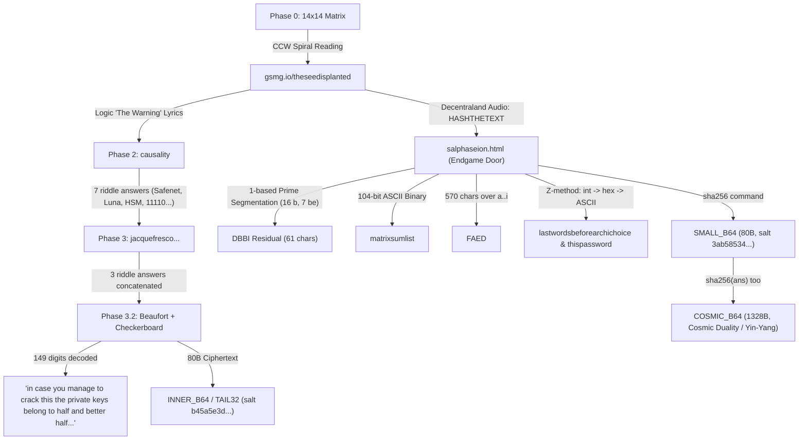

# GSMG Meganigma (5 BTC) Cryptanalytic Architecture & Breakthrough Analysis

## 1. Executive Summary

- **Target Address**: [`1GSMG1JC9wtdSwfwApgj2xcmJPAwx7prBe`](https://blockstream.info/api/address/1GSMG1JC9wtdSwfwApgj2xcmJPAwx7prBe) (~1.2537 BTC unspent).
- **Secondary Address**: [`17ucy1K9ZUAaoY6JVtM932W9jUp5LXfyHa`](https://blockstream.info/api/address/17ucy1K9ZUAaoY6JVtM932W9jUp5LXfyHa) (3.7505 BTC unspent, halving recipient).
- **Creator**: Jrk Bgrt (@SoWut), GSMG Dutch team.
- **Uncompressed Public Key ($P$)**:
  `04f4d1bbd91e65e2a019566a17574e97dae908b784b388891848007e4f55d5a4649c73d25fc5ed8fd7227cab0be4e576c0c6404db5aa546286563e4be12bf33559`
- **Compressed Public Key Address**: `1cc6xayvqpeetixmuXDRsGug7GKyoRdxP`.

---

## 2. Verified Upstream Cryptographic Trajectory



---

## 3. Decisive Discoveries & Creator Evidence

### A. The Critical Bottleneck: `SMALL_B64`
On 2025-04-28 (Telegram Message #39237), a solver asked:
> **Solver (#39233)**: *"is yinyang found after decoding an AES ciphertext?"*  
> **Creator (Jrk Bgrt)**: *"It’s the next phase, but I await the day someone finally gets there."*

- `COSMIC_B64` (Cosmic Duality) **is** the Yin-Yang phase.
- Yin-Yang can **only** be unlocked after decoding `SMALL_B64`.
- The creator confirmed:
  > *"Once you hit a 'ying yang', you'll be able to solve it the same day"*  
  > *"when yingyang is reached, 2 hours max"*  
  > *"very last step is a true giveaway promised"*

### B. The 80-Byte Dual Key Geometry
- Both `SMALL_B64` (`3ab58534...`) and `INNER_B64` (`b45a5e3d...`) are **exactly 80 bytes** of AES ciphertext (5 blocks of 16 bytes).
- Under PKCS#7 padding, 80 bytes corresponds to **64 bytes of plaintext** + 16 bytes of `0x10` padding:
  $$\text{Plaintext} = 32\text{ bytes (Half)} + 32\text{ bytes (Better Half)} = 64\text{ bytes}$$
- This perfectly matches Phase 3.2's decoded checkerboard text:
  > *"the private keys belong to half and better half and they also need funds to live"*

### C. Refutation of Phantoms & Falsified Paths
1. **`YOUWON` / `Tail64`**:
   - The creator explicitly dismissed this in message #70307:
     > **Solver**: *"In the YOUWON text, positions {1,4,21} give VIC ... exactly 103 digits..."*  
     > **Creator**: *"Pfff. Coincidence."*
   - Cryptanalysis proved `YOUWON` has a look-elsewhere probability of ~3% across difference texts and carries no cryptographic signal.
2. **`BTCSEED` / `Chain 1-4` (Issue #55 / #110)**:
   - Proved to be a solver hoax based on a 1/256 single-byte `0x01` PKCS#7 padding collision under EVP-MD5. The resulting high-entropy plaintexts and derived scam addresses (`1JG648...`, `145ZQ9...`) are not the prize.
3. **ECDSA Nonce Exploitation**:
   - The spend transactions from `1GSMG...` were signed with standard Bitcoin Core RFC 6979 deterministic nonces; no lattice/BSGS vulnerability exists.

---

## 4. Analysis of `salphaseion.html` Instructions

Right before `SMALL_B64`, the text specifies:
```text
z lastwordsbeforearchichoice
z thispassword
z shabef our first hint is your last command
[SMALL_B64 split by 'enter']
shabef ans too
[COSMIC_B64]
```

1. **`shabef` = `sha256`** ($s=19, h=8, a=1, b=2, e=5, f=6$).
2. **"our first hint is your last command"**:
   - The very first audio hint in the puzzle was `HASHTHETEXT` ("Hash the text!").
   - "Your last command" instructs the solver to apply `sha256` to the text preceding it (`lastwordsbeforearchichoice` or the composite answer).
3. **`shabef ans too`**:
   - Once `SMALL_B64` is decrypted to yield `ans`, `sha256(ans)` is used as the password to decrypt `COSMIC_B64` ("hash answer too").

---

## 5. Creator Context & "Close Friends"

On 2026-07-13 (#66574), Jrk stated:
> *"My close friends have the best chance of solving it (a few tried). But they don't have the skills some of you do. NOTE: that is a hint."*

- **Operational interpretation**: The password is not a high-complexity mathematical construct. It belongs to his personal/cultural register (Dutch informal, favorite movies/quotes, or shared Matrix/GSMG humor), created in *"a couple of hours / two sloppy days"*.
- **Brute force allowance**: In Phase 3.2, the Architect speech explicitly warned:
  > *"NOTE THAT ALSO BRUTE FORCING MIGHT BE REQUIRED"*
  and the creator personally donated to the `vs-kangaroo-hybrid` developer on 2020-04-07. If an approximate scalar or key prefix is obtained, Pollard's Kangaroo provides the final bounded search.
